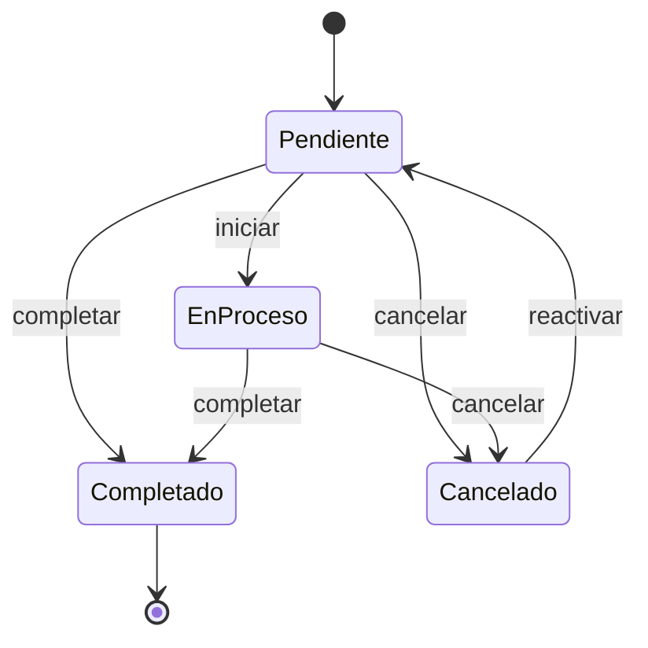
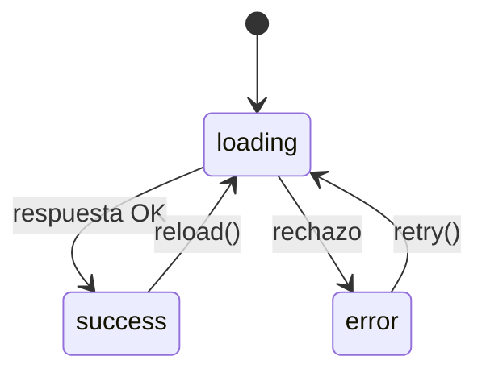
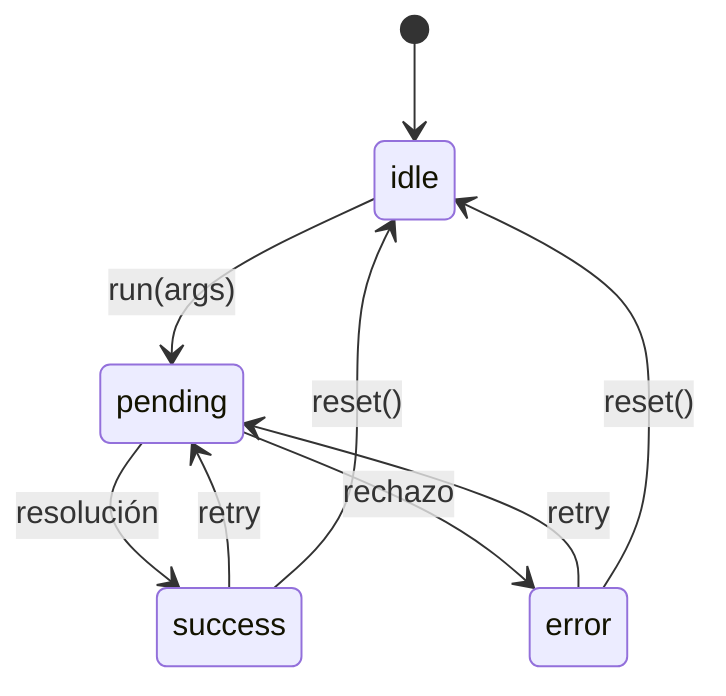

# Máquinas de estado de Asty Petshop Manager

Este documento es el mapa de todos los estados implícitos que existían en la app y dónde quedaron modelados de forma explícita. Si vas a cambiar una regla de negocio, cambia **una sola fuente de verdad** y actualiza este archivo.

## Principios

1. **Una sola fuente de verdad por dominio.** El ciclo de vida del servicio vive en `shared/serviceLifecycle.ts` y lo importan backend y frontend.
2. **Nada de comparar strings de estado.** Usa los helpers (`normalizeServiceStatus`, `getServiceStatusMeta`, `canTransitionServiceStatus`, `isServiceStatusOpen`, etc.).
3. **Estados imposibles no se representan.** Los hooks usan uniones discriminadas: no puede haber `loading=true` y `error=true` a la vez.
4. **Toda escritura pasa por una transición validada.** El backend rechaza transiciones ilegales aunque la UI tenga un bug.
5. **Los datos heredados no se rompen.** Los alias (`Pagado`, `Listo`, `Agendado`, etc.) se normalizan al leer y al escribir.

---

## 1. Ciclo de vida del servicio

**Fuente de verdad:** `shared/serviceLifecycle.ts`
**Validador backend:** `backend/src/controllers/services.controller.ts`
**Consumidores UI:** `Dashboard.tsx`, `GetClients.tsx`, `GetClientsAdmin.tsx`, `PostClient.tsx`

### Estados canónicos

| Clave | Etiqueta persistida | Categoría | Tono UI | Significado |
| --- | --- | --- | --- | --- |
| `pending` | `Pendiente` | `pending` | `warning` | Registrado, aún no inicia |
| `in_progress` | `En proceso` | `in_progress` | `info` | La mascota está siendo atendida |
| `completed` | `Completado` | `completed` | `success` | Servicio terminado |
| `cancelled` | `Cancelado` | `cancelled` | `danger` | Servicio anulado |

### Transiciones legales



| Desde | Hacia | Permitido |
| --- | --- | --- |
| `pending` | `in_progress`, `completed`, `cancelled` | Sí |
| `in_progress` | `completed`, `cancelled` | Sí |
| `completed` | — (terminal) | No |
| `cancelled` | `pending` | Sí |
| Cualquiera | El mismo estado | Sí (no-op idempotente) |
| Estado desconocido/heredado | Cualquier estado canónico | Sí (permite reparar datos viejos) |

### Invariantes

- El backend **rechaza** un estado desconocido al crear o actualizar (`400 INVALID_SERVICE_STATUS`).
- El backend **rechaza** una transición ilegal (`409 INVALID_SERVICE_TRANSITION`).
- Al completar desde la UI se registra el pago completo (`paid_amount = price`) si el caller no envía otro monto.
- Un `completed` repetido sin `paid_amount` es idempotente: no vuelve a tocar el pago.
- La UI solo ofrece acciones cuyas transiciones estén en `getServiceStatusMeta(status).allowedTransitions`.

### Alias heredados

Los valores viejos se siguen leyendo y escribiendo sin migración:

- `Pagado`, `Pagada`, `Finalizado`, `Entregado`, `Listo`, `Terminado` → `completed`
- `Agendado`, `Programado`, `En espera` → `pending`
- `Proceso`, `En curso`, `En progreso` → `in_progress`
- `Rechazado`, `Vencido`, `Anulado` → `cancelled`

Los alias se normalizan con acentos, mayúsculas, guiones y espacios incluidos. Al escribir se persiste siempre la etiqueta canónica.

### Dónde tocar

| Cambio | Archivo |
| --- | --- |
| Agregar/renombrar estado o transición | `shared/serviceLifecycle.ts` |
| Agregar alias heredado | `shared/serviceLifecycle.ts` (`SERVICE_STATUS_ALIASES`) |
| Cambiar validación HTTP | `backend/src/controllers/services.controller.ts` |
| Cambiar reglas visuales | `getServiceStatusMeta(...).tone/label` en los componentes |

---

## 2. Estado de pago (derivado)

**Fuente de verdad:** `getServicePayment` / `getServiceDebt` en `shared/serviceLifecycle.ts`

No se persiste un segundo estado. Se deriva de `price` y `paid_amount` para evitar la desincronización clásica “status dice pagado, paid_amount dice otra cosa”.

| Estado | Regla |
| --- | --- |
| `unpaid` | `paid <= 0` |
| `partial` | `0 < paid < price` |
| `paid` | `paid === price` |
| `overpaid` | `paid > price` |

`debt = max(price - paid, 0)`. La UI usa `getServiceDebt` y el backend valida que `paid_amount` sea finito, no negativo y no mayor al precio en escrituras nuevas.

---

## 3. Lectura remota (`useAsyncResource`)

**Archivo:** `frontend/src/hooks/useAsyncResource.ts`

Antes: `loading`, `error` y `clients` eran tres `useState` que podían contradecirse, y dos vistas no tenían ni error ni loading.



- El estado es una unión discriminada `loading | success | error`.
- `data` puede sobrevivir a un retry, pero `status` siempre manda.
- Cada request tiene un `requestId`; una respuesta vieja no pisa a una nueva.
- Al desmontar se invalidan requests pendientes.
- `setData` aplica mutaciones optimistas solo si ya hay datos cargados.

**Usado en:** `Dashboard`, `GetClients`, `GetClientsAdmin`.

---

## 4. Mutación remota (`useAsyncAction`)

**Archivo:** `frontend/src/hooks/useAsyncAction.ts`

Antes: cada vista inventaba su propio booleano (`updatingServiceId`, `hasPaid`, ningún estado en el formulario), lo que permitía dobles envíos y dejaba errores sin mostrar.



- `args` viven dentro del estado: la UI sabe **qué fila** está pendiente, sin un booleano extra.
- Un lock interno (`pendingRef`) hace que un doble clic sea inofensivo.
- `run` devuelve el resultado o `null`; los errores quedan en `state.error` con el mensaje JSON del backend.
- Los componentes derivan sus banners de `success`/`error` en lugar de guardar mensajes duplicados.

**Usado en:** `PostClient` (registro), `Dashboard` y `GetClients` (completar servicio), `GetClientsAdmin` (borrar servicio).

---

## 5. Registro atómico

**Antes:** `POST /clients` → `POST /pets` → `POST /services`. Si el segundo o tercer request fallaba, quedaban clientes/mascotas huérfanos. Además no había estado de envío y un doble clic creaba registros duplicados.

**Ahora:** `POST /registrations` hace un nested write de Prisma:

```text
clients
  └── client_phones
  └── pets
        └── services
```

- Todo se crea o nada se crea.
- La UI usa `useAsyncAction`: `idle → pending → success | error`, botón deshabilitado y texto “Guardando…”.
- El formulario conserva sus valores si falla; solo se resetea tras `success`.
- `status` inicial por defecto: `pending` (`Pendiente`).

**Archivos:** `backend/src/controllers/registration.controller.ts`, `frontend/src/services/registrations.service.ts`, `frontend/src/components/PostClient.tsx`.

---

## 6. Paginación

**Archivo:** `frontend/src/hooks/usePagination.ts`

Antes cada tabla repetía `page`, `currentPage`, `totalPages`, `slice` y los mismos `disabled`. Al borrar filas la página podía quedar fuera de rango.

- `requestedPage` es la intención; `page` es siempre el valor seguro en `[1, totalPages]`.
- `previous`/`next` se calculan desde la página segura, nunca desde una página fantasma.
- `reset()` vuelve a la primera página (útil después de borrar).

**Usado en:** `GetClients`, `GetClientsAdmin`.

---

## 7. Filtros del dashboard (estado de selección)

**Archivo:** `frontend/src/components/Dashboard.tsx`

`DashboardPeriod` (`today | 7d | 30d | month | year | custom`) es un estado explícito y ya tipado. El rango (`start`, `end`, `days`) y la etiqueta son **derivados** con `useMemo`; no se guardan copias que puedan desincronizarse. `customDate` solo participa cuando `period === "custom"`.

No se convirtió en XState porque no tiene transiciones complejas: es una selección con valores finitos y un valor derivado.

---

## 8. Estados que se dejaron simples a propósito

| Estado | Por qué no es una FSM |
| --- | --- |
| `showRevenue` | Booleano de visibilidad sin transiciones |
| `hasPaid` | Booleano de formulario; su efecto se valida al enviar |
| `petAge` | Enum cerrado (`Cachorro`/`Adulto`) sin transiciones |
| Ruta activa del navbar | Derivada de React Router |
| Confirmación de borrado | `window.confirm` es síncrono; el estado `pending` de la mutación cubre el borrado real |
| Edición admin | Hoy es un aviso de “no disponible”; no existe modo edición que modelar |

---

## Checklist para cambios futuros

- [ ] ¿Agregué un estado nuevo? Actualiza `SERVICE_STATUS`, definiciones, transiciones y alias en `shared/serviceLifecycle.ts`.
- [ ] ¿Agregué una transición? Actualiza `SERVICE_STATUS_TRANSITIONS` y la tabla de este doc.
- [ ] ¿Toqué una vista? Usa los hooks de lectura/mutación en lugar de booleanos manuales.
- [ ] ¿Toqué una escritura? Valida en backend; la UI no es la única puerta de entrada.
- [ ] ¿Pasan las pruebas? `cd backend && npm test`.
- [ ] ¿Compila? `cd backend && npm run build` y `cd frontend && npm run build && npm run lint`.
